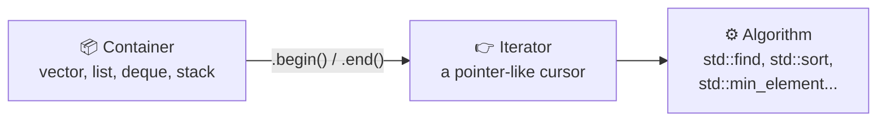
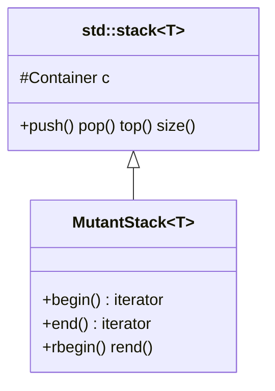

# CPP Module 08: STL Containers, Iterators and Algorithms

> **Big idea:** Don't build your own array, list or sort. C++ already has them in the **STL** (Standard Template Library).
> You learn the three parts: **containers** hold data, **iterators** walk through it, **algorithms** do the work.

[⬅ Back to all modules](../../tree/main)

---

## 🧠 Concepts in Plain Words



### Containers used here

| Container | Think of it as | Fast at |
|---|---|---|
| `std::vector` | a dynamic array | random access `v[i]`, adding at the end |
| `std::list` | a chain of nodes | inserting in the middle |
| `std::deque` | a double-ended array | adding at the front **and** the back |
| `std::stack` | a pile of plates (adapter) | `push` / `pop` / `top` only |

### Iterators: one way to walk every container

```
  begin()                                end()
     ▼                                     ▼
   [ 1 ][ 2 ][ 3 ][ 4 ][ 5 ]  (one past the last element)
```

`end()` is **one past** the last element, so "not found" is reported as `end()`.

### Algorithms

They work on **any** container through iterators:

```cpp
std::find(v.begin(), v.end(), 5);        // search
std::sort(v.begin(), v.end());           // sort
std::min_element(v.begin(), v.end());    // smallest value
```

---

## 📂 Exercises

### ex00: Easy find 🔍

A function template that finds an `int` in **any** container. It throws if the value isn't there.

```cpp
template <typename T>
typename T::iterator easyfind(T &container, int value) {
    typename T::iterator it = std::find(container.begin(), container.end(), value);
    if (it == container.end())
        throw std::runtime_error("not found");
    return it;
}
```

`typename` tells the compiler that `T::iterator` is a **type**, not a variable.

### ex01: Span 📏

A class that stores up to **N** numbers and finds:

- **`shortestSpan()`**: the smallest gap between any two numbers. Sort them, then compare neighbours.
- **`longestSpan()`**: the biggest gap, which is `max - min`.

```
numbers:  6  3  17  9  11
sorted:   3  6  9  11  17
gaps:      3  3  2   6        → shortest = 2
max - min = 17 - 3            → longest  = 14
```

There's also an `addNumber(begin, end)` that adds a whole **range** at once, so you can fill 10,000 numbers in one call.

### ex02: Mutated abomination 🧬

`std::stack` normally **cannot be iterated**. `MutantStack` inherits from it and exposes the hidden container inside (`this->c`), which adds `begin()` and `end()`:



```cpp
MutantStack<int> s;
s.push(5); s.push(17);
for (MutantStack<int>::iterator it = s.begin(); it != s.end(); ++it)
    std::cout << *it;    // now possible!
```

---

## ▶️ How to Run

```bash
git checkout module08
cd ex00 && make && ./easyfind
cd ../ex01 && make && ./span
cd ../ex02 && make && ./mutantstack
```

Compiled with `c++ -Wall -Wextra -Werror -std=c++98`.
