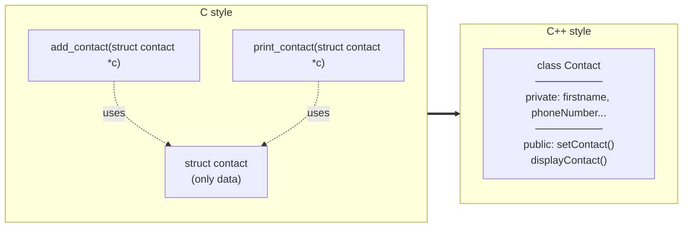
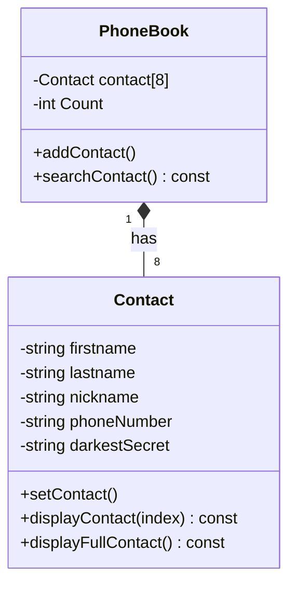

# CPP Module 00: First Steps in C++

> **Big idea:** In C, data (a `struct`) and the functions that use it are separate.
> In C++ you put them **together** in a **class**, and you decide what the outside world is allowed to touch.

[⬅ Back to all modules](../../tree/main)

---

## 🧠 Concepts in Plain Words

| Concept | What it means | Where I used it |
|---|---|---|
| **Class** | A blueprint: data + the functions that work on that data | `Contact`, `PhoneBook` |
| **Object** | One real "thing" built from the blueprint | `PhoneBook phonebook;` |
| **`private` / `public`** | `private` = only the class can touch it. `public` = anyone can use it | Contact fields are private, `setContact()` is public |
| **Member function** | A function that belongs to a class | `addContact()`, `searchContact()` |
| **Constructor** | Runs automatically when the object is created, sets starting values | `PhoneBook::PhoneBook()` sets the counters to 0 |
| **`const` function** | Promises "I will only read, not change anything" | `searchContact() const` |
| **`std::string`** | A real string type. No `malloc`, no `free`, it grows by itself | All contact fields |
| **iostream** | `std::cout` prints, `std::cin` / `std::getline` read input | Everywhere |
| **`std::setw`** | Makes columns line up when printing | The search table |

### C vs C++ in one picture



---

## 📂 Exercises

### ex00: Megaphone 📢

Takes the program's arguments and prints them in **UPPERCASE**.

```bash
$ ./megaphone "shhhhh... I think the students are asleep..."
SHHHHH... I THINK THE STUDENTS ARE ASLEEP...
```

**What I learned:** using `std::string`, `std::cout` and `toupper()`. It's the C++ "hello world".

---

### ex01: My Awesome PhoneBook ☎️

A small phonebook that stores up to **8 contacts**. It reads three commands:

| Command | What it does |
|---|---|
| `ADD` | Asks for first name, last name, nickname, phone number, darkest secret. No field can be empty, and the phone number must be digits only. When the book is full, the **oldest** contact is replaced |
| `SEARCH` | Shows all contacts in a table with 10-character columns (longer text is cut and ends with `.`), then shows one contact in full |
| `EXIT` | Quits the program |



**Example:**

```
Enter a command (ADD, SEARCH, EXIT): SEARCH
     Index|First Name| Last Name|  Nickname|
----------|----------|----------|----------|
         0|       Ada|  Lovelace|       Ada|
Enter the index of the contact to view details: 0
First name: Ada
Last name: Lovelace
...
```

**What I learned:**
- Splitting a program into classes that each have **one job**: `Contact` holds one person, `PhoneBook` manages the list
- Hiding data with `private` so only the class itself can change it
- A fixed array of objects instead of dynamic memory (the subject forbids `new` here), used as a **circular buffer**: the 9th contact goes back to slot 0
- Handling end of input (Ctrl+D) with `std::getline`, so the program exits cleanly instead of looping forever
- Reading full lines with `std::getline` and formatting columns with `std::setw`

---

## ▶️ How to Run

```bash
git checkout module00
cd ex00 && make && ./megaphone "hello world"
cd ../ex01 && make && ./PhoneBook
```

Compiled with `c++ -Wall -Wextra -Werror -std=c++98`.
