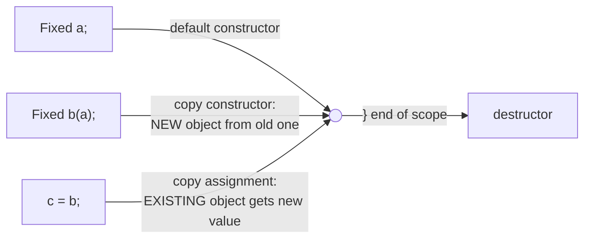

# CPP Module 02: Operator Overloading and the Orthodox Canonical Form

> **Big idea:** You can teach your own class to work with `+`, `<`, `++` and `<<` just like an `int`.
> And every class should know how to be **created, copied, assigned and destroyed** correctly.

[⬅ Back to all modules](../../tree/main)

---

## 🧠 Concepts in Plain Words

### 1. Orthodox Canonical Form: the "4 must-haves"

From this module on, every class has these four:

```cpp
class Fixed {
public:
    Fixed();                               // 1. Default constructor   → Fixed a;
    Fixed(const Fixed &other);             // 2. Copy constructor      → Fixed b(a);
    Fixed &operator=(const Fixed &other);  // 3. Copy assignment       → c = b;
    ~Fixed();                              // 4. Destructor            → end of scope
};
```



> **Copy constructor vs assignment:** the copy constructor **builds a new** object.
> Assignment **overwrites an object that already exists**.

### 2. Operator Overloading

You write a function named `operator+`, `operator<` and so on, and C++ calls it when it sees the symbol:

```cpp
Fixed a(2), b(3.5f);
Fixed c = a + b;      // C++ calls a.operator+(b)
if (a < b) ...        // C++ calls a.operator<(b)
std::cout << c;       // C++ calls operator<<(std::cout, c)
```

### 3. Fixed-point numbers: what this module builds

A **float** can't store some values exactly (try `0.1 + 0.2`).
A **fixed-point** number is just an **int** where we agree that the last **8 bits** are the fraction part.

```
   value stored in int:   0000 0000 0000 0000 0000 0001 | 1000 0000
                          └────── integer part ───────┘ └─ 8 frac ─┘
                                        1                  .5        →  1.5
```

| Conversion | How | Why |
|---|---|---|
| int → fixed | `value = n << 8` | shift left by 8 = multiply by 256 |
| float → fixed | `value = roundf(f * 256)` | scale up, then round |
| fixed → float | `value / 256.0f` | scale back down |
| fixed → int | `value >> 8` | drop the 8 fraction bits |

So the smallest step is **1/256 = 0.00390625**, which is exactly what `++a` adds.

---

## 📂 Exercises

| Ex | What it adds | Key point |
|---|---|---|
| **ex00** My First Class in Orthodox Canonical Form | `Fixed` with the 4 must-haves + `getRawBits()` / `setRawBits()` | The basic shape of a class |
| **ex01** Towards a more useful fixed-point number class | Constructors from `int` and `float`, `toInt()`, `toFloat()`, `operator<<` | Converting with bit shifts |
| **ex02** Now we're talking | 6 comparison operators, `+ - * /`, `++`/`--` (prefix and postfix), static `min()` / `max()` | Full operator overloading |

### Prefix vs Postfix `++`

```cpp
Fixed &operator++();     // ++a : add first, then return the NEW value (returns a reference)
Fixed  operator++(int);  // a++ : save a copy, add, return the OLD copy (returns a value)
```

The `int` parameter is a **fake parameter**. It's only there so C++ can tell the two apart.

### Output of ex02

```
0             ← a
0.00390625    ← ++a   (adds 1/256, returns new value)
0.00390625    ← a
0.00390625    ← a++   (returns OLD value, then adds)
0.0078125     ← a     (now 2/256)
10.1016       ← b = 5.05 * 2
10.1016       ← max(a, b)
```

---

## ▶️ How to Run

```bash
git checkout module02
cd ex02 && make && ./Fixed
```

Compiled with `c++ -Wall -Wextra -Werror -std=c++98`.
