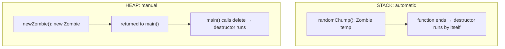
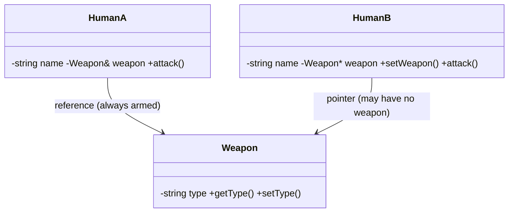
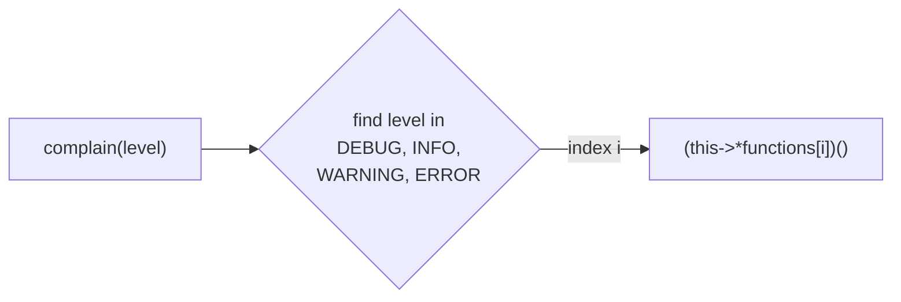

# CPP Module 01: Memory, References and Pointers to Members

> **Big idea:** In C++ you choose **where** an object lives (stack or heap), and you can refer to an object with a **pointer** or a **reference**.
> Each choice changes who is responsible for cleaning it up.

[⬅ Back to all modules](../../tree/main)

---

## 🧠 Concepts in Plain Words

### Stack vs Heap

| | **Stack** | **Heap** |
|---|---|---|
| How | `Zombie z("Bob");` | `Zombie *z = new Zombie("Bob");` |
| Lives until | the end of the `{ }` block | you call `delete` |
| Cleanup | automatic | **your job** (or it leaks) |
| Use when | you only need it right here | it must outlive the function |



### `new` / `delete` vs `new[]` / `delete[]`

```cpp
Zombie* one   = new Zombie("A");   delete one;      // single object
Zombie* horde = new Zombie[5];     delete[] horde;  // array: needs []
```

### Pointer vs Reference

| | **Pointer** `Weapon*` | **Reference** `Weapon&` |
|---|---|---|
| Can be empty? | Yes, can be `NULL` | **No**, must point to something from the start |
| Can change target? | Yes | No, it's tied to one object forever |
| Syntax | `ptr->getType()` | `ref.getType()` |
| Think of it as | an address written on paper | a **nickname** for the object |

### Pointer to member function

You can store **member functions** in an array and call them by index. That gets rid of long `if / else if` chains:

```cpp
void (Harl::*functions[4])() = { &Harl::debug, &Harl::info, &Harl::warning, &Harl::error };
(this->*functions[i])();   // call the i-th one
```

---

## 📂 Exercises

### ex00: BraiiiiiiinnnzzzZ 🧟

Two ways to make a zombie:

- `newZombie()` creates it on the **heap**, so it survives after the function returns and the caller must `delete` it.
- `randomChump()` creates it on the **stack**, so it's destroyed automatically when the function returns.

```
Zombie1 is born!
Zombie1 BraiiiiiiinnnzzzZ...
Zombie1 is destroyed!      ← when main() calls delete
Zombie2 is born!
Zombie2 BraiiiiiiinnnzzzZ...
Zombie2 is destroyed!      ← automatically, at the end of randomChump()
```

### ex01: Moar brainz! 🧟🧟🧟

`zombieHorde(N, name)` creates **N zombies in a single allocation** (`new Zombie[N]`). It's freed with **`delete[]`**.

```
Zombie_0 BraiiiiiiinnnzzzZ...
...
Zombie_4 is destroyed!   ← destroyed in reverse order
...
Zombie_0 is destroyed!
```

### ex02: HI THIS IS BRAIN 🧠

Prints the address and the value of one string accessed three ways: directly, through a pointer, and through a reference.

```
0x7ffd...040   ← &name
0x7ffd...040   ← namePTR
0x7ffd...040   ← &nameREF   (same address: a reference IS the object)
HI THIS IS BRAIN
HI THIS IS BRAIN
HI THIS IS BRAIN
```

### ex03: Unnecessary violence ⚔️



- **HumanA** always has a weapon, so it stores a **reference** that is set in the constructor.
- **HumanB** may have no weapon at first, so it stores a **pointer** that starts as `NULL` and is set later with `setWeapon()`.
- Both see the change when the weapon's type is changed, because neither one copied it.

```
Bob attacks with their crude spiked club
Bob attacks with their some other type of club     ← same Weapon object, new type
Jim attacks with their crude spiked club
Jim attacks with their some other type of club
```

### ex04: Sed is for losers 🔁

`./replace <file> <s1> <s2>` copies `<file>` into `<file>.replace`, with every `s1` replaced by `s2`. It uses `std::ifstream` / `std::ofstream`. The subject forbids `std::string::replace`, so the search and replace is done by hand.

```bash
$ cat t.txt
hello world
hello 42
$ ./replace t.txt hello bye && cat t.txt.replace
bye world
bye 42
```

### ex05: Harl 2.0 🗣️

`Harl::complain("WARNING")` finds the matching level and calls the right private function through an **array of pointers to member functions**, without any `if/else` chain. An unknown level is simply ignored.



---

## ▶️ How to Run

```bash
git checkout module01
cd ex00 && make && ./Zombie
cd ../ex01 && make && ./horde
cd ../ex02 && make && ./brain
cd ../ex03 && make && ./attack
cd ../ex04 && make && ./replace test hello bye
cd ../ex05 && make && ./Harl
```

Compiled with `c++ -Wall -Wextra -Werror -std=c++98`.
