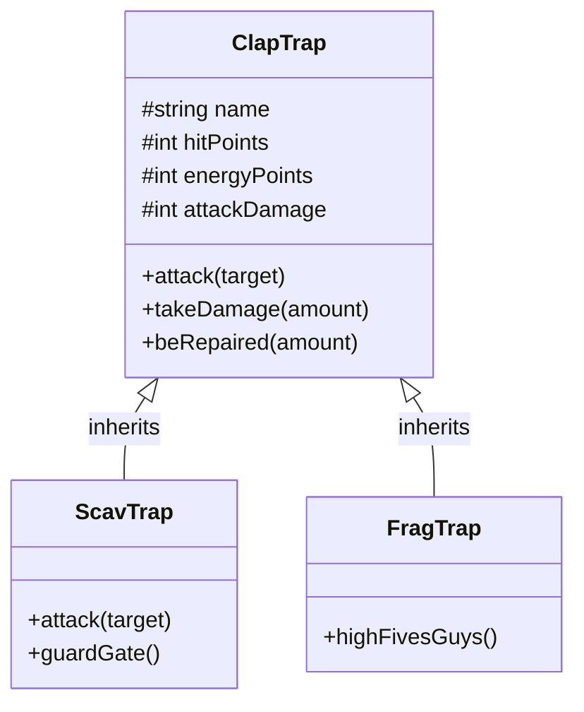
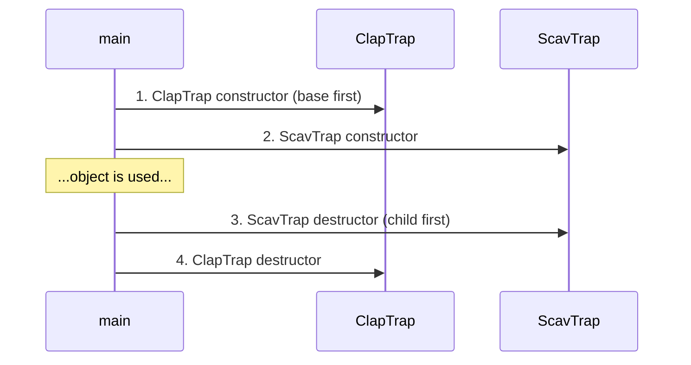

# CPP Module 03: Inheritance

> **Big idea:** Don't write the same code twice. A new class can **inherit** everything from an existing class,
> then change or add only what is different.

[⬅ Back to all modules](../../tree/main)

---

## 🧠 Concepts in Plain Words

### Inheritance = "is a"

A `ScavTrap` **is a** `ClapTrap`, just stronger and with one extra skill.



### `protected`: the middle level of access

| Keyword | Who can use it |
|---|---|
| `public` | everyone |
| `protected` | the class **and its children** |
| `private` | only the class itself |

In ex00 the stats were `private`. To let `ScavTrap` and `FragTrap` change them, they became **`protected`**.

### Construction and destruction order

The parent is built **first** and destroyed **last**, like building a house: foundation first, demolished last.



```
ClapTrap Scavvy constructed.     ← parent part
ScavTrap Scavvy constructed.     ← child part
...
ScavTrap destructed called.      ← child cleaned first
ClapTrap Scavvy destructed.      ← parent cleaned last
```

### Overriding

A child can **replace** a parent's function with its own version. `ScavTrap::attack()` prints `ScavTrap ...` instead of `ClapTrap ...`.

---

## 📂 Exercises

| | ClapTrap | ScavTrap | FragTrap |
|---|:-:|:-:|:-:|
| Hit points | 10 | 100 | 100 |
| Energy points | 10 | 50 | 100 |
| Attack damage | 0 | 20 | 30 |
| Special skill | – | `guardGate()` | `highFivesGuys()` |

- **ex00 Aaaaand... OPEN!**: `ClapTrap`. Attacking or repairing costs 1 energy point, and nothing works with 0 hit points or 0 energy.
- **ex01 Serena, my love!**: `ScavTrap` inherits from `ClapTrap`, with different stats, its own `attack()`, and `guardGate()`.
- **ex02 Repetitive work**: `FragTrap` is another child of `ClapTrap`, with `highFivesGuys()`.

### Output of ex01

```
ClapTrap Clappy attacks Scavvy, causing 0 points of damage!
ClapTrap Scavvy takes 5 points of damage! (Hit Points left: 95)
ClapTrap Scavvy is repaired by 3 points! (Hit Points: 98, Energy left: 49)
ScavTrap Scavvy attacks Clappy, causing 20 points of damage!
```

Notice that `takeDamage` and `beRepaired` print **ClapTrap**: ScavTrap didn't rewrite them, it **inherited** them.

### Output of ex02

```
ClapTrap Clappy attacks Scavvy, causing 0 points of damage!
ScavTrap Scavvy attacks Clappy, causing 20 points of damage!   ← ScavTrap's own attack()
ClapTrap Fraggy attacks Clappy, causing 30 points of damage!   ← FragTrap uses the inherited attack()
FragTrap Fraggy is requesting a high five!
```

---

## ▶️ How to Run

```bash
git checkout module03
cd ex01 && make && ./ClapTrap
cd ../ex02 && make && ./ClapTrap
```

Compiled with `c++ -Wall -Wextra -Werror -std=c++98`.
