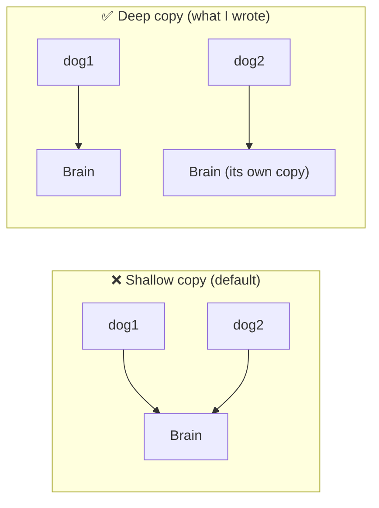
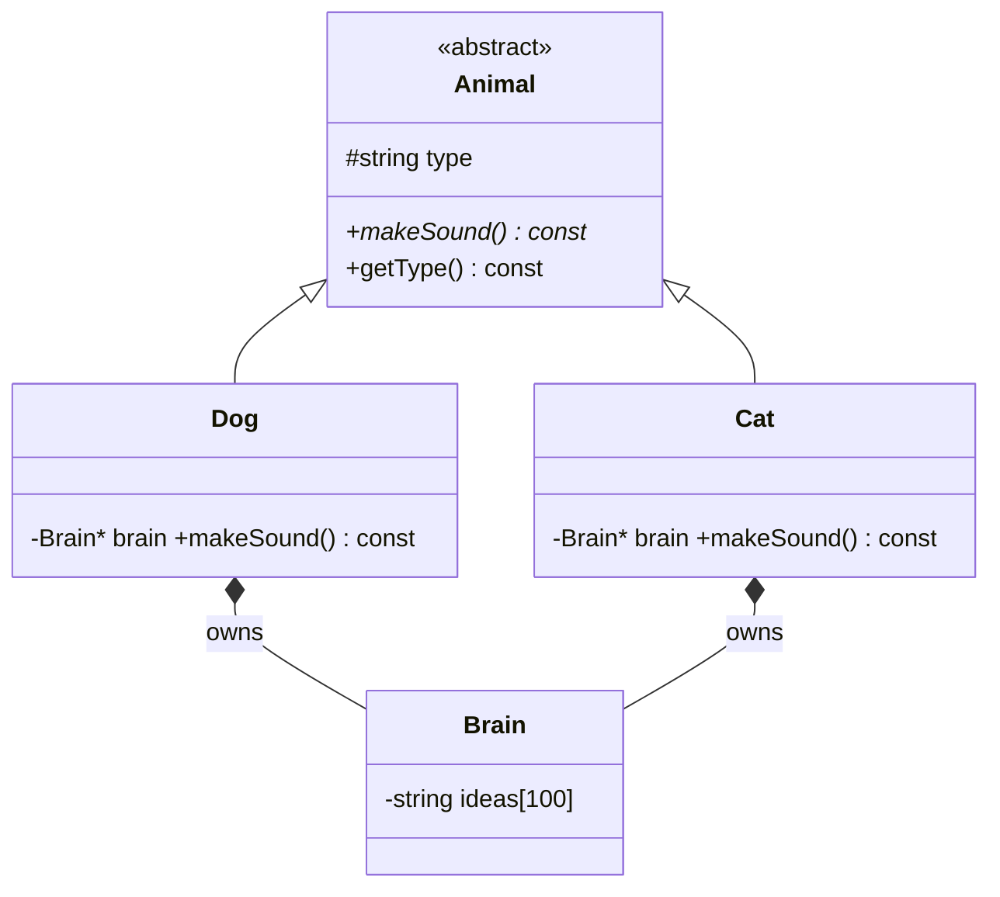

# CPP Module 04: Polymorphism, Deep Copy and Abstract Classes

> **Big idea:** One pointer type, `Animal*`, can hold a `Dog` or a `Cat`, and the **right** sound plays.
> That's **polymorphism**, and the magic word is `virtual`.

[⬅ Back to all modules](../../tree/main)

---

## 🧠 Concepts in Plain Words

### 1. `virtual`: choose the function at run time

```cpp
Animal* pet = new Dog();
pet->makeSound();
```

| `makeSound()` in Animal is... | What C++ calls | Output |
|---|---|---|
| **`virtual`** | the real object's version → `Dog::makeSound()` | `Woof Woof!` ✅ |
| **not virtual** | the pointer type's version → `Animal::makeSound()` | `Animal sound` ❌ |

ex00 shows both side by side: `Animal`/`Cat` use `virtual`, `WrongAnimal`/`WrongCat` don't.

```
Meow Meow!                   ← Animal* → Cat        (virtual: correct)
WrongAnimal makes a sound    ← WrongAnimal* → WrongCat (not virtual: wrong one!)
```

### 2. Virtual destructor

If you `delete` a `Dog` through an `Animal*` and the destructor is **not** virtual, only `~Animal()` runs, and the Dog's `Brain` leaks.
With `virtual ~Animal()`, the full chain runs: `~Dog()` then `~Animal()`.

### 3. Shallow copy vs Deep copy

Each `Dog` / `Cat` owns a `Brain*` (100 ideas), allocated with `new`.



With a shallow copy, both dogs share **one** brain. Changing one changes the other, and when both are destroyed the brain is **deleted twice** 💥.
So the copy constructor and `operator=` allocate a **new** Brain:

```cpp
Dog::Dog(const Dog& other) : Animal(other) {
    this->brain = new Brain(*other.brain);   // a new brain, copied
}
```

Output proving it works:

```
Dog1 idea: Changed idea!
Dog2 idea: I love bones!     ← dog2 kept its own idea
```

### 4. Abstract class

A generic "Animal" makes no sense on its own, so `makeSound()` becomes **pure virtual**:

```cpp
virtual void makeSound() const = 0;   // "= 0" → every child MUST write this
```

Now `new Animal()` **does not compile**, and only `Dog` and `Cat` can exist.



---

## 📂 Exercises

| Ex | Topic | What it shows |
|---|---|---|
| **ex00** Polymorphism | `virtual` functions | `Cat` says *Meow* through `Animal*`. `WrongCat` doesn't, because `WrongAnimal` isn't virtual |
| **ex01** I don't want to set the world on fire | Deep copy + virtual destructor | Array of `Animal*` (half dogs, half cats), each with its own `Brain`, deleted without leaks |
| **ex02** Abstract class | Pure virtual function | `Animal` can no longer be created directly |

---

## ▶️ How to Run

```bash
git checkout module04
cd ex00 && make && ./Animals
cd ../ex02 && make && ./Animals
```

Compiled with `c++ -Wall -Wextra -Werror -std=c++98`.
