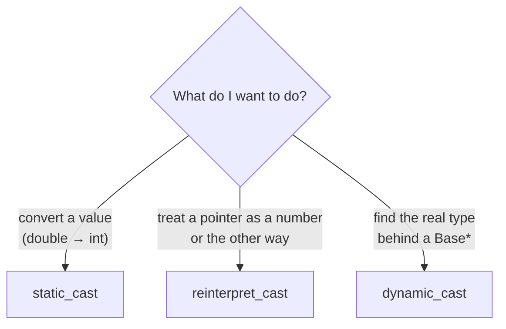
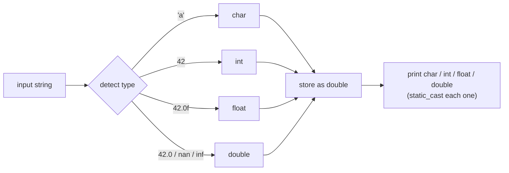
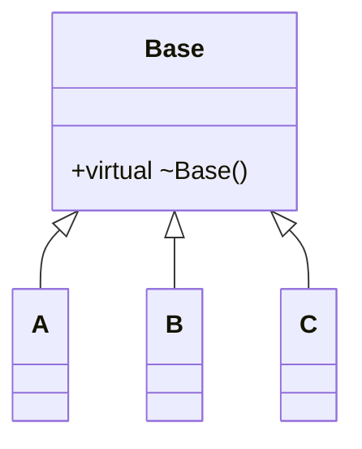

# CPP Module 06: C++ Casts

> **Big idea:** In C there is one cast, `(int)x`, and it does anything you ask, even dangerous things.
> C++ splits casting into **named casts**, so you say exactly **what kind** of conversion you mean.

[⬅ Back to all modules](../../tree/main)

---

## 🧠 Concepts in Plain Words

| Cast | Use it for | Checked? | Used in |
|---|---|---|---|
| `static_cast<T>` | "normal" conversions: `double → int`, `int → char` | at compile time | **ex00** |
| `reinterpret_cast<T>` | read the same bits as a completely different type (pointer ↔ integer) | ❌ not checked, you're on your own | **ex01** |
| `dynamic_cast<T>` | "is this `Base*` really a `B`?" in a class hierarchy | ✅ checked **at run time** | **ex02** |
| `const_cast<T>` | remove `const` | — | not needed here |



---

## 📂 Exercises

### ex00: Conversion of scalar types 🔢

`ScalarConverter::convert()` takes a string literal, finds its type (**char, int, float or double**), and prints it in all four types.



| Input | char | int | float | double |
|---|---|---|---|---|
| `42` | `'*'` | `42` | `42.0f` | `42.0` |
| `a` | `'a'` | `97` | `97.0f` | `97.0` |
| `0` | Non displayable | `0` | `0.0f` | `0.0` |
| `nan` | impossible | impossible | `nanf` | `nan` |
| `-inff` | impossible | impossible | `-inff` | `-inf` |
| `2147483648` | impossible | impossible (too big) | `2.14748e+09f` | `2147483648.0` |

The class can't be created (its constructor is `private`), so you just call `ScalarConverter::convert(...)`. It's used like a toolbox.

### ex01: Serialization 📦

Turn a pointer into a plain number, and that number back into the same pointer.

```cpp
uintptr_t raw = Serialize::serialize(&myData);   // pointer → number  (reinterpret_cast)
data*     ptr = Serialize::deserialize(raw);     // number  → pointer (reinterpret_cast)
// ptr == &myData  ✅
```

```
Address: 0x7fffd22e5750
Raw value: 140736719640400      ← same address, written as a decimal number
Address: 0x7fffd22e5750
SUCCESS: Pointers match!
```

`uintptr_t` is an integer type that is guaranteed to be big enough to hold a pointer.

### ex02: Identify real type 🕵️

`generate()` randomly creates an `A`, `B` or `C` and returns it as a `Base*`. Then `identify()` finds out which one it really is:



| `identify(Base* p)` | `identify(Base& p)` |
|---|---|
| `dynamic_cast<A*>(p)` returns **NULL** if it's not an A | `dynamic_cast<A&>(p)` **throws** if it's not an A (a reference can't be NULL) |
| so: check `if (a)` | so: `try { ... } catch (...) {}` |

`Base` needs at least one **virtual** function (its destructor) so `dynamic_cast` can look up the real type at run time.

---

## ▶️ How to Run

```bash
git checkout module06
cd ex00 && make && ./convert 42.5f
cd ../ex01 && make && ./serialize
cd ../ex02 && make && ./base
```

Compiled with `c++ -Wall -Wextra -Werror -std=c++98`.
