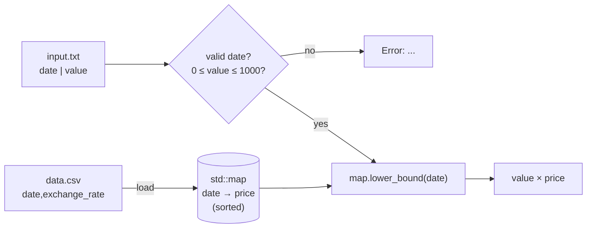
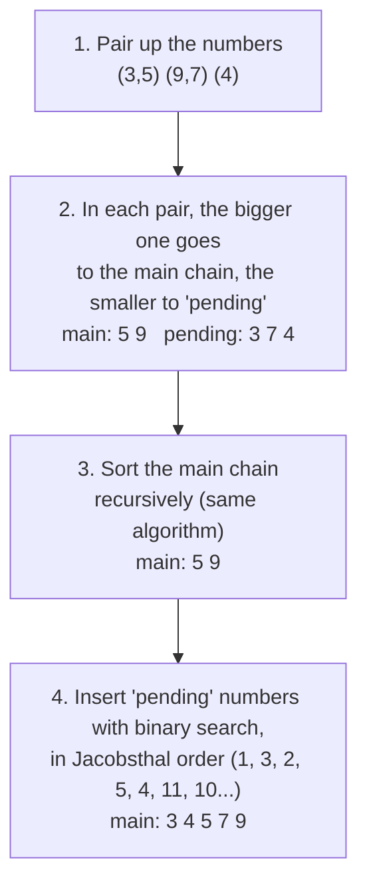

# CPP Module 09: STL in Practice

> **Big idea:** Three real problems, each solved by choosing the **right container** for the job.
> Each container can be used in only one exercise, so you have to think about which fits best.

[⬅ Back to all modules](../../tree/main)

---

## 🗺️ Which container, and why

| Exercise | Container | Why this one |
|---|---|---|
| ex00 Bitcoin Exchange | `std::map` | keeps dates **sorted** automatically and can find the **closest earlier date** |
| ex01 RPN | `std::stack` | RPN is literally a stack algorithm: push numbers, pop two for each operator |
| ex02 PmergeMe | `std::vector` + `std::list` | sort the same numbers with two different containers and compare the time |

---

## 📂 Exercises

### ex00: Bitcoin Exchange ₿

Reads a price database (`data.csv`, about 1,600 dates) and an input file of `date | amount`, then prints how much that amount of bitcoin was worth on that date.



**The key trick:** if the exact date isn't in the database, use the **closest earlier date**.
`std::map` is sorted, so `lower_bound()` finds it quickly, and stepping back one gives the previous date.

```
$ ./btc input.txt
Error: bad input => 2011-01-93          ← day 93 doesn't exist
2011-01-03 => 2 = 0.6
2011-01-03 => 1.2 = 0.36
Error: not a positive number.
Error: bad input => 2001-42-42
2012-01-11 => 1 = 7.1
Error: too large a number.              ← over 1000
```

Date validation checks the format `YYYY-MM-DD`, the month range, the days in each month, and **leap years**.

---

### ex01: Reverse Polish Notation 🧮

In RPN the operator comes **after** the numbers, so there are no brackets:

| Normal | RPN |
|---|---|
| `(3 + 4) × 2` | `3 4 + 2 *` |

**The algorithm:** read left to right. A **number** is pushed. An **operator** pops two numbers, computes, and pushes the result.

```
Input: "3 4 + 2 *"

token   stack (top on the right)
  3     [3]
  4     [3, 4]
  +     [7]          ← pop 4 and 3, push 3+4
  2     [7, 2]
  *     [14]         ← pop 2 and 7, push 7*2
                     result = 14
```

Errors (not enough numbers, division by zero, leftover numbers, bad token) → `Error`.

---

### ex02: PmergeMe (Ford-Johnson merge-insertion sort) 🔀

Sorts positive integers with the **Ford-Johnson** algorithm. It's designed to use as **few comparisons as possible**.
The same sort is written twice, once for `std::vector` and once for `std::list`, and both are timed.



**Why the Jacobsthal order?** Inserting in that special order keeps every binary search over a range of size 2ⁿ−1, which saves comparisons.

```
$ ./PmergeMe 3 5 9 7 4
Before: 3 5 9 7 4
After: 3 4 5 7 9
Time to process a range of 5 elements with std::vector : 25.00000 us
Time to process a range of 5 elements with std::list : 16.00000 us
```

Invalid input (negative numbers, letters, values over `INT_MAX`) → `Error`.

---

## ▶️ How to Run

```bash
git checkout module09
cd ex00 && make && ./btc input.txt
cd ../ex01 && make && ./RPN "3 4 + 2 *"
cd ../ex02 && make && ./PmergeMe 3 5 9 7 4
```

Compiled with `c++ -Wall -Wextra -Werror -std=c++98`.
