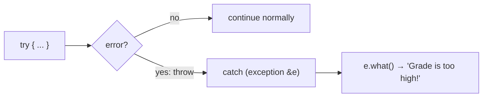
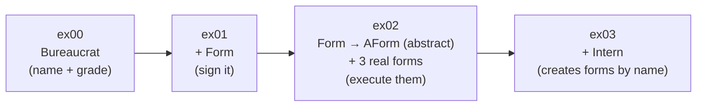

# CPP Module 05: Exceptions

> **Big idea:** When something goes wrong, don't return `-1` and hope someone checks it.
> **Throw** an exception, and let the code that knows how to handle it **catch** it.

[⬅ Back to all modules](../../tree/main)

---

## 🧠 Concepts in Plain Words

### `try` / `throw` / `catch`

```cpp
try {
    Bureaucrat b("Bob", 0);          // grade 0 is invalid...
}
catch (const std::exception &e) {    // ...so we land here
    std::cout << "Exception: " << e.what() << std::endl;
}
```



### Making your own exception

Inherit from `std::exception` and override `what()`:

```cpp
class GradeTooHighException : public std::exception {
public:
    const char* what() const throw() { return "Grade is too high!"; }
};
```

The class is written **inside** `Bureaucrat` (a *nested class*), so its full name is `Bureaucrat::GradeTooHighException`.

### The grade system

```
 1 ◀──────────── higher authority ──────────── lower authority ────────────▶ 150
 (best)                                                                   (worst)
```

- A grade below 1 throws `GradeTooHighException`.
- A grade above 150 throws `GradeTooLowException`.
- `incrementGrade()` makes the number **smaller** (a promotion: 3 → 2).

---

## 📂 Exercises



### ex00: Mommy, when I grow up, I want to be a bureaucrat!

A `Bureaucrat` with a constant name and a grade from 1 to 150. A bad grade **throws**.

```
Exception: Grade is too high!
Exception: Grade is too low!
Alice, bureaucrat grade 2
After increment: Alice, bureaucrat grade 1
```

### ex01: Form up, maggots!

A `Form` has a grade required **to sign** and a grade required **to execute**.
`Bureaucrat::signForm()` tries to sign it and prints the result either way:

```
thaqer signed deadshot
noob couldn't sign Important Doc because Grade is too low!
```

### ex02: No, you need form 28B, not 28C...

`Form` becomes the **abstract** `AForm`, and there are three real forms:

| Form | Sign | Exec | When executed |
|---|:-:|:-:|---|
| `ShrubberyCreationForm` | 145 | 137 | writes ASCII trees into `<target>_shrubbery` 🌳 |
| `RobotomyRequestForm` | 72 | 45 | drilling noises, then 50% chance of success 🤖 |
| `PresidentialPardonForm` | 25 | 5 | `<target> has been pardoned by Zaphod Beeblebrox.` |

📖 **Detailed explanation:** [ex02/README.md](ex02/README.md)

### ex03: At least this beats coffee-making

An `Intern` builds forms from a name, such as `makeForm("robotomy request", "Bender")`.
It uses an **array of function pointers** instead of an `if/else` chain.

📖 **Detailed explanation:** [ex03/README.md](ex03/README.md)

---

## ▶️ How to Run

```bash
git checkout module05
cd ex00 && make && ./bureaucrat
cd ../ex03 && make && ./bureaucrat
```

Compiled with `c++ -Wall -Wextra -Werror -std=c++98`.
