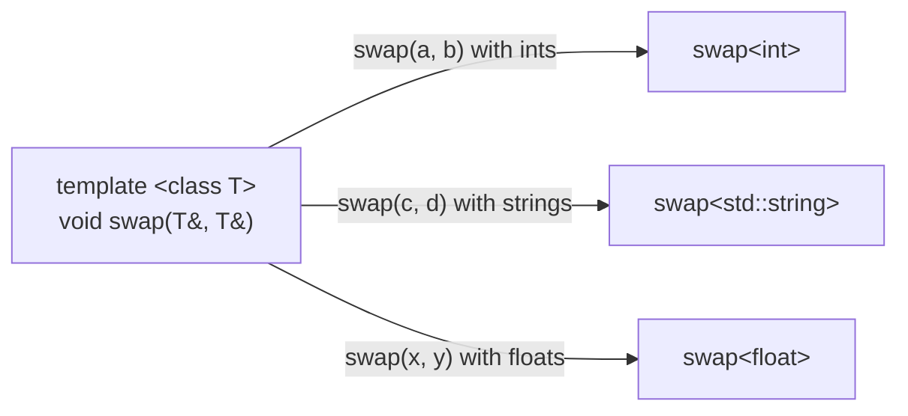
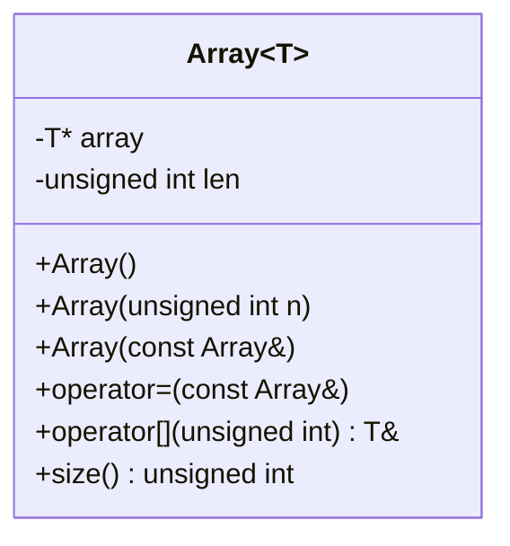

# CPP Module 07: Templates

> **Big idea:** Write the code **once**, and let the compiler create a version for every type you use.
> `swap` for `int`, `swap` for `std::string`, `swap` for anything: one template.

[⬅ Back to all modules](../../tree/main)

---

## 🧠 Concepts in Plain Words

### Without templates vs with templates

```cpp
// ❌ Without: the same function copied for every type
void swap(int &a, int &b)               { int t = a; a = b; b = t; }
void swap(std::string &a, std::string &b) { std::string t = a; a = b; b = t; }

// ✅ With a template: written once
template <class T>
void swap(T &a, T &b) { T t = a; a = b; b = t; }
```

`T` is a **placeholder** for a type. The compiler replaces it with the real type when you call the function.



### Why templates live in the header (`.hpp`)

The compiler has to **see the full template code** at the moment it creates `swap<int>`.
That's why template code goes in `.hpp` (or `.tpp`) files, not in a separate `.cpp`.

### Function template vs Class template

| | Function template | Class template |
|---|---|---|
| Example | `template <class T> T &max(T &a, T &b)` | `template <class T> class Array { T *array; }` |
| Usage | `max(a, b)`: type is **guessed** automatically | `Array<int> arr(5);`: type is **written** |

---

## 📂 Exercises

### ex00: Start with a few functions

`swap`, `min` and `max` as function templates. They work with any type that has `<` and `>`.

```
a = 3, b = 2
min( a, b ) = 2
max( a, b ) = 3
c = chaine2, d = chaine1
min( c, d ) = chaine1
max( c, d ) = chaine2
```

### ex01: Iter

`iter(array, length, function)` calls a function on **every element** of an array of any type.

```cpp
template <class A, class B>
void iter(A* array, size_t len, B fun) {
    for (size_t i = 0; i < len; i++)
        fun(array[i]);
}
```

```
Int array: 1 2 3 4 5
String array: Hello World
After increment: 2 3 4 5 6
```

Both the element type `A` and the function type `B` are templates, so it works with any array and any matching function.

### ex02: Array

A **class template** `Array<T>`: a safe array that knows its own `size()` and checks the index in `operator[]`.

- `new T[n]()` gives every element its **default value** (`0` for `int`, `""` for `std::string`)
- Copy constructor and `operator=` make a **deep copy**: each array owns its own memory
- `operator[]` **throws** `std::out_of_range` for a bad index
- The template code is in `Array.tpp`, which `array.hpp` includes at the end



```
Empty array size: 0
Array<int>(3): 0 0 0
Array<std::string>: Hello 42
original: 1 2 3
copy:     100 2 3        ← changing the copy didn't touch the original
assigned: 1 200 3
original[3]: Array: index out of bounds
original[-2]: Array: index out of bounds
750 random values match: yes
```

---

## ▶️ How to Run

```bash
git checkout module07
cd ex00 && make && ./whatever
cd ../ex01 && make && ./iter
cd ../ex02 && make && ./array
```

Compiled with `c++ -Wall -Wextra -Werror -std=c++98`.
